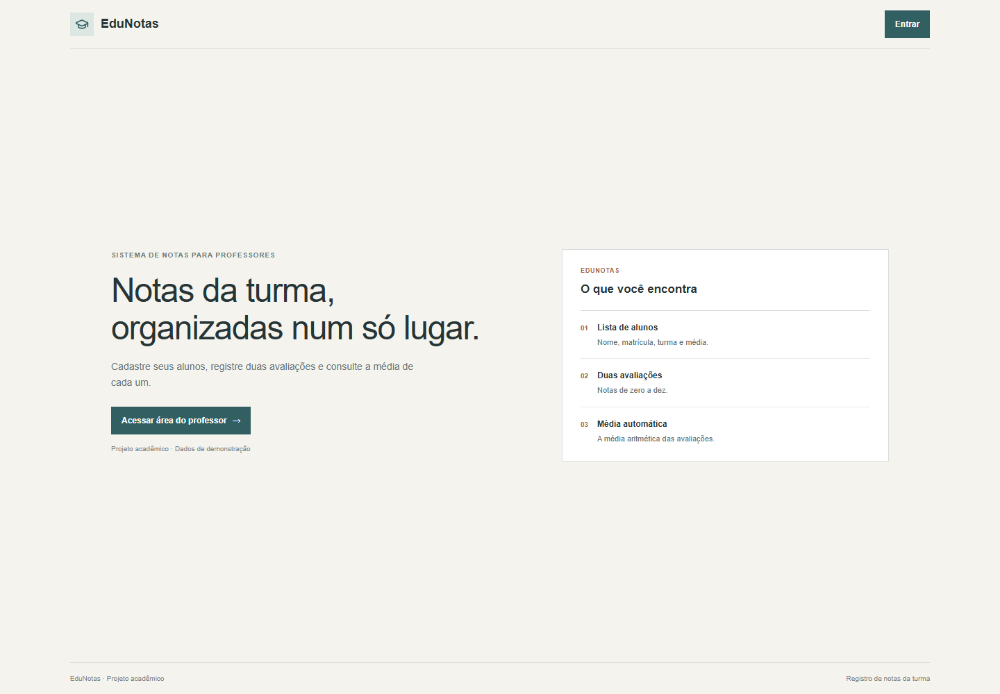
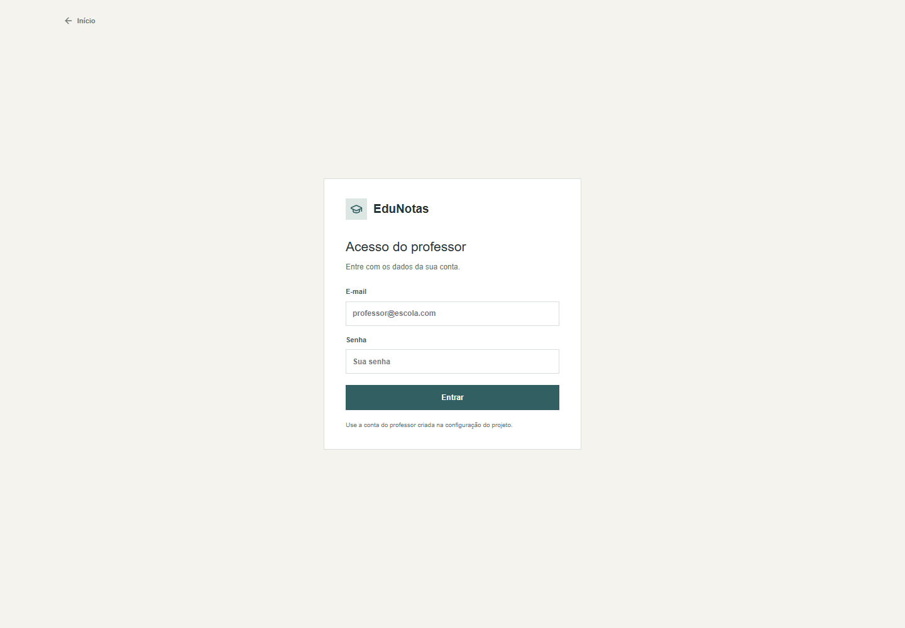
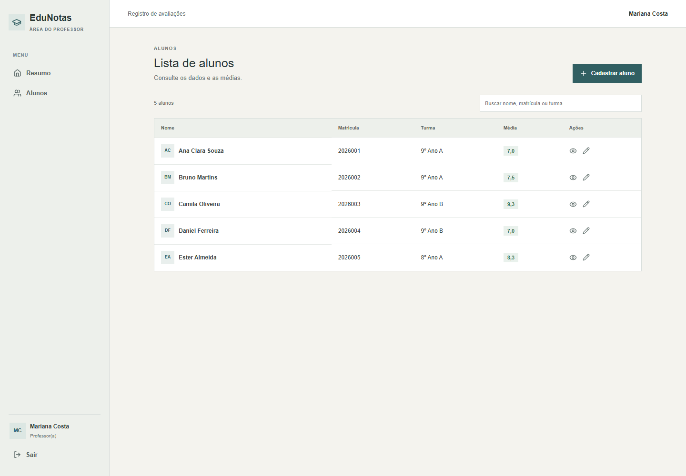
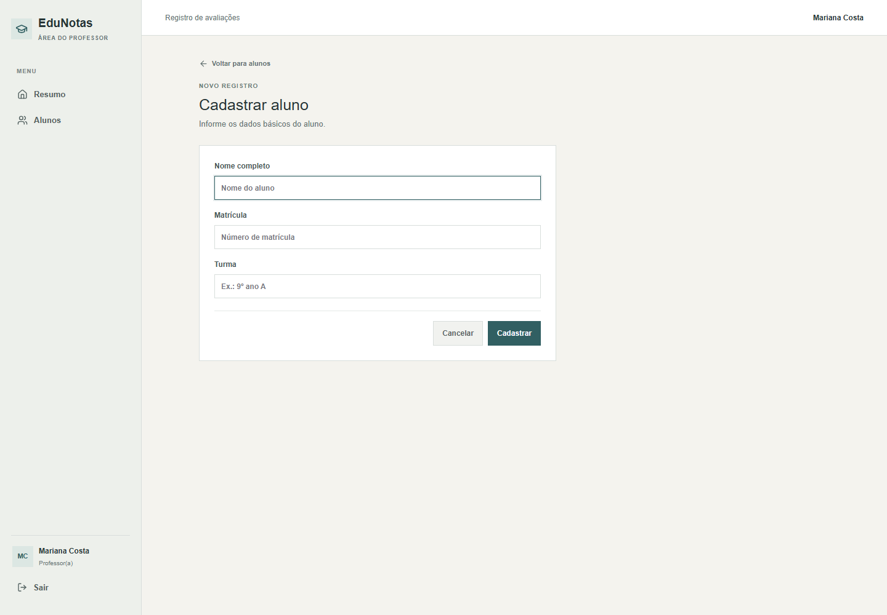
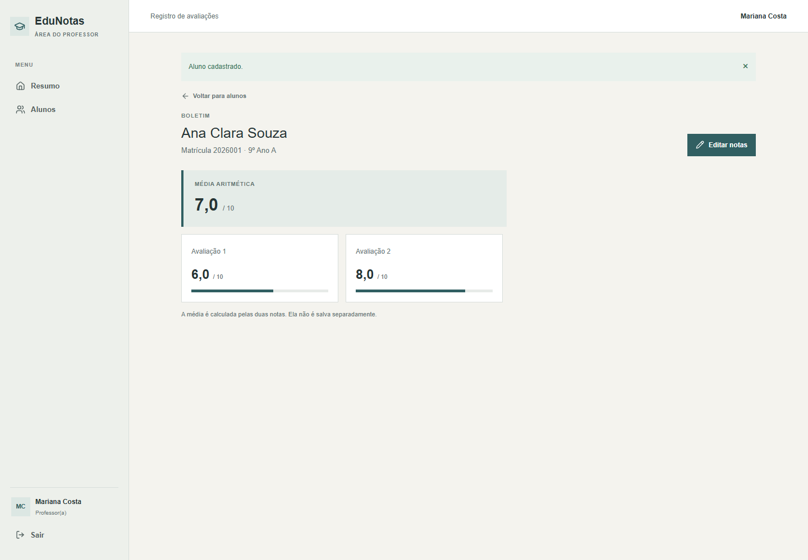
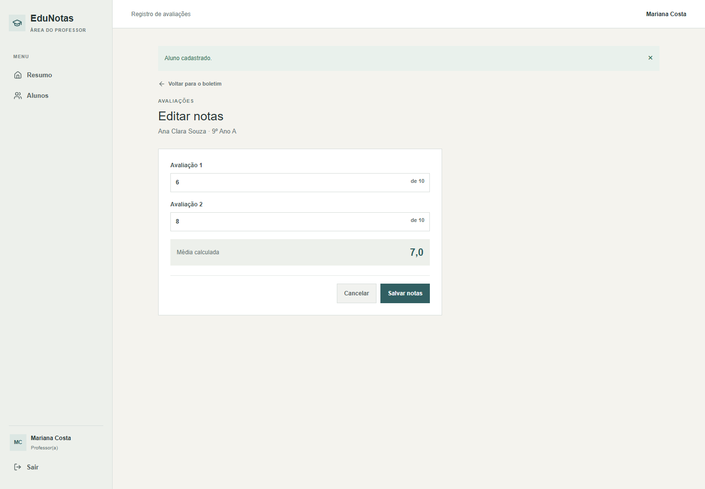

# EduNotas Entrega 3 Telas implementadas

**Data prevista:** 16/11/2026  
**Capturas:** Playwright · 1440 × 1000 px

As imagens mostram o frontend conectado à API local. Os registros da tabela são exemplos fictícios criados pelo seed do banco. Os formulários e notas são os dados retornados e enviados pela API.

## Página inicial

## Login do professor

## Lista de alunos

## Cadastro de aluno

## Boletim

## Edição de notas

As capturas correspondem às rotas `/`, `/login`, `/alunos`, `/alunos/novo`, `/alunos/:id` e `/alunos/:id/editar`. O arquivo Playwright que percorre essas páginas também testa o envio do cadastro e da edição.
